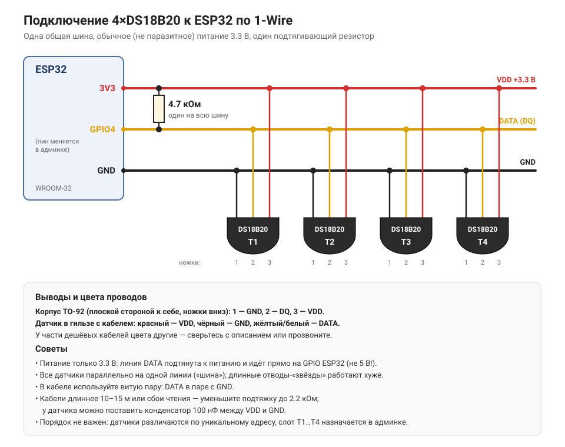

# ThermoHub — ESP32 + 4×DS18B20 + AHT20/BMP280 + LCD2004 + енкодер

Автономна прошивка (Arduino/PlatformIO): вебадмінка, REST API, виведення на LCD
українською, корекція датчиків з енкодера та з вебу. Усі налаштування зберігаються
в енергонезалежній пам'яті (NVS) і не губляться після вимкнення живлення чи оновлення.

## Збирання та прошивка

```bash
pio run -t upload && pio device monitor
```

Подальші оновлення можна заливати через веб: «Система → Оновлення прошивки»
(файл `.pio/build/esp32dev/firmware.bin`).

## Релізи та оновлення

### Збирання на GitHub (`.github/workflows/firmware.yml`)

- Кожен push у `main` і кожен PR збирає прошивку; результат — артефакт збірки.
- Тег `v*` (наприклад `v1.2.0`) створює **GitHub Release** з файлами:
  - `firmware.bin` — образ для оновлення (через інтернет або з файлу в адмінці);
  - `firmware.sig` — підпис `firmware.bin` (ECDSA P‑256, SHA‑256);
  - `factory.bin` — повний образ для чистого чипа (записується з адреси `0x0`);
  - `SHA256SUMS`.
- Версія прошивки береться з тегу (`git describe`): `v1.2.0` → `1.2.0`,
  проміжні збірки — `1.2.0-3-gabc1234`.

Випуск нової версії:

```bash
git tag v1.2.0 && git push origin v1.2.0
```

### Ключ підпису (налаштовується один раз)

Прошивки з інтернету встановлюються **лише з дійсним підписом**. Відкритий ключ
лежить у `keys/fw-signing-pub.pem` і вшивається в прошивку; закритий — **ніколи не
комітиться**, а зберігається в секреті репозиторію `FW_SIGNING_KEY`:

```bash
gh secret set FW_SIGNING_KEY --repo set-st/esp32-thermo < ~/.config/thermohub/fw-signing-key.pem
```

Без цього секрету збірка тегу завершиться помилкою (непідписаний реліз пристрої
однаково не встановили б). Збережіть резервну копію закритого ключа: якщо його
втратити, пристрої з поточним відкритим ключем не приймуть нових оновлень через
інтернет (лише прошивку з файлу/USB). Новий ключ: `openssl ecparam -name prime256v1
-genkey -noout -out key.pem` і `openssl ec -in key.pem -pubout -out keys/fw-signing-pub.pem`.

### Оновлення через інтернет

Адмінка → «Система» → «Оновлення через інтернет»: «Перевірити оновлення» показує
нову версію та її опис, «Встановити» завантажує `firmware.bin` з GitHub, перевіряє
підпис і лише потім перемикає пристрій на нову прошивку (на дисплеї — прогрес).
Якщо ввімкнено автоперевірку, пристрій раз на добу дивиться останній реліз і показує
банер «Доступна нова прошивка» (встановлення — лише за кнопкою).

Перша прошивка «з нуля»: `esptool.py --chip esp32 write_flash 0x0 factory.bin`.

## Підключення (за замовчуванням, усе змінюється в адмінці)

| Периферія                       | GPIO | Примітка                              |
|---------------------------------|------|---------------------------------------|
| I2C SDA (LCD, AHT20+BMP280)     | 21   |                                       |
| I2C SCL                         | 22   |                                       |
| 1‑Wire (4×DS18B20)              | 4    | резистор **4.7 кОм** DATA → 3.3 В     |
| Енкодер A (CLK)                 | 32   |                                       |
| Енкодер B (DT)                  | 35   | лише вхід, без внутрішньої підтяжки   |
| Кнопка енкодера (SW)            | 33   |                                       |
| Енкодер `+` / `GND`             | 3.3 В / GND | живить підтяжки модуля — обов'язково |

Адреси I2C: LCD визначається автоматично (0x27/0x3F…), AHT20 — 0x38,
BMP280 — 0x77 або 0x76.

### Термодатчики DS18B20 (1‑Wire)



- Усі датчики підключаються **паралельно** до трьох спільних ліній: VDD (3.3 В), DATA, GND.
- Між DATA і 3.3 В ставиться **один** резистор 4.7 кОм на всю шину (не на кожен датчик).
- Виводи TO‑92 (пласкою стороною до себе, ніжки донизу): 1 — GND, 2 — DQ, 3 — VDD.
  Датчик із кабелем: червоний — VDD, чорний — GND, жовтий/білий — DATA.
- Живити від 3.3 В, не від 5 В: DATA йде прямо на GPIO ESP32.
- Порядок підключення не важливий — кожен датчик має унікальну адресу. Нові датчики
  під час завантаження самі займають порожні слоти; перепризначити їх можна на вкладці
  «Термодатчики» (кнопка «Сканувати шину»). Щоб зрозуміти, який датчик який,
  підключайте їх по одному або нагрійте рукою й подивіться, чиї показники ростуть.
- Довгі кабелі (понад 10–15 м) або збої читання: зменшити підтяжку до 2.2 кОм,
  використовувати виту пару (DATA в парі з GND).

## Перший запуск

1. Мережу не задано → пристрій піднімає точку доступу `ThermoHub-XXXX`
   (пароль `thermohub`), адмінка на http://192.168.4.1. Назва мережі, пароль і адреса
   на 8 с виводяться на LCD, після чого дисплей залишається на сторінці мережі.
2. Вкладка Wi‑Fi → «Знайти мережі» → вибрати мережу → ввести пароль →
   «Зберегти і перезавантажити».
3. Після підключення отримана IP-адреса на 5 с з'являється на LCD, далі вона завжди
   видна на сторінці мережі; також пристрій доступний як `http://thermohub.local`.

Якщо Wi‑Fi зник більш ніж на 20 с, знову піднімається точка доступу (мережа при цьому
продовжує перепідключатися). Якщо **тримати кнопку енкодера під час увімкнення**,
пристрій примусово завантажується в режимі точки доступу. Причина невдалого
підключення (невірний пароль, слабкий сигнал, мережу не знайдено) показується
на вкладці Wi‑Fi та на дисплеї.

## Дисплей

Підтримуються дисплеї 20×4 (за замовчуванням), 16×4, 20×2 і 16×2.

**Мова і шрифт.** Службові написи на дисплеї — англійською (`Temperature`, `Pressure`,
`Calibration`…): стандартний знакогенератор HD44780 (ROM A00) не має кирилиці, а транслит
службових написів читається погано. Кирилиця потрібна лише для власних назв датчиків
(і назви Wi‑Fi‑мережі): за замовчуванням вони виводяться українським транслітом
(«Вихід котел» → `Vykhid kotel`). Для дисплеїв із кириличним ROM (наприклад, контролер
SPLC780D1‑002A) в адмінці можна вибрати «Кирилиця»: тоді назви виводяться кирилицею,
а відсутні в ROM **Є є Ї ї Ґ ґ** малюються в шести користувацьких комірках CGRAM.
Перевірити, що вміє ваш дисплей, можна тестом `POST /api/display/charset {"page":0}`:
у рядках A0–D0 мають бути кириличні літери (на самому екрані, не в емуляторі).

**Підсвітка** (адмінка → «Система»): завжди увімкнена, вимикати після N хвилин без дій
або вимкнена. У режимі автовимкнення перший дотик до енкодера лише вмикає підсвітку
(сторінка не перемикається); важливі повідомлення (IP, перезапуск) теж її вмикають.
Плата I2C (PCF8574) вміє лише вмикати/вимикати підсвітку — плавна яркість потребує
ШІМ з GPIO через транзистор.

Сторінки на 20×4:
1. чотири DS18B20, кожен у своєму рядку, з назвою;
2. AHT20 (температура, вологість) і BMP280 (тиск, температура);
3. зведення: усі датчики на одному екрані;
4. мережа: IP, назва мережі, сигнал, час роботи (у режимі точки доступу — її назва,
   пароль і адреса).

На 2‑рядковому дисплеї сторінки 1, 2 і 4 у компактному вигляді, без зведення.

Текст, що не вміщується у своє поле (довга назва датчика), прокручується біжучим
рядком усередині поля, решта рядка стоїть на місці.

### Енкодер

| Режим       | Обертання               | Клік                  | Довге натискання    |
|-------------|-------------------------|-----------------------|---------------------|
| Перегляд    | зміна сторінки          | наступна сторінка     | меню корекції       |
| Меню        | T1…T4 / Вихід           | редагувати            | вихід               |
| Редагування | ±0.1 °C (швидко ±0.5)   | **зберегти**          | скасувати           |

Декодер енкодера — скінченний автомат: крок зараховується лише після повної
послідовності A/B, тож брязкіт контактів або «смикання» однієї лінії не дає хибних
кроків. «Кроків на клацання» (адмінка → «Піни»): 4 — повний цикл на клацання,
2 — половина циклу (більшість KY‑040), 1 — кожен перехід. Діагностика енкодера
(рівні A/B/SW, лічильники фронтів, підсвітка кнопок віртуального енкодера) — на вкладці «Моніторинг».
**Модуль енкодера потрібно живити:** вивід `+` → 3.3 В, `GND` → GND, інакше його
підтягувальні резистори не працюють і натискання кнопки «смикає» лінії A/B.

У меню корекції видно `сире>з поправкою`. Через 30 с без дій меню закривається
без збереження.

### Емулятор дисплея

На вкладці «Моніторинг» показується точна копія того, що зараз на LCD, намальована
матрицею 5×8 точок шрифтом знакогенератора (оновлення раз на 0.4 с). Кнопки ⟲ ● ⟳
і «Довге натискання» працюють як енкодер — можна гортати сторінки й вносити корекцію
віддалено. Працює й без підключеного дисплея.

### Перегляд API в адмінці

Унизу вкладки «Моніторинг» — список GET‑методів із кнопкою «Отримати»: відповідь
показується у вікні з підсвіткою синтаксису JSON, статусом HTTP, часом і розміром,
її можна скопіювати. POST‑методи описані там же (у згорнутому блоці).

## Демо-режим DS18B20

Поки датчиків немає, увімкніть перемикач «Демо-режим» на вкладці «Термодатчики»
(або `POST /api/config {"dsDemo":true}`). Усі 4 слоти видають правдоподібні
повільно змінні значення (~21, 45, 62 і 4 °C), поправка до них застосовується
як до справжніх, тож меню енкодера та API можна перевірити повністю.
Ознаки демо-режиму: банер і мітка «ДЕМО» в адмінці, `"demo": true` в
`/api/sensors`, літера `D` у правому верхньому куті сторінки з термодатчиками на LCD,
метрика `thermohub_ds18b20_demo 1`. Вмикається й вимикається одразу, без перезавантаження.

## Послідовна консоль

`pio device monitor` (115200): під час завантаження видно, що знайдено на шинах, які мережі
бачить радіо і чому не вдається підключитися (код причини). Команди: `scan`,
`status`, `reboot`.

## API

Авторизації немає — пристрій розрахований на закриту локальну мережу.

| Метод | Шлях                   | Опис |
|-------|------------------------|------|
| GET   | `/api/sensors`         | усі показники (JSON, CORS відкритий) |
| GET   | `/metrics`             | формат Prometheus |
| GET   | `/api/config`          | налаштування (пароль Wi‑Fi не віддається) + info |
| POST  | `/api/config`          | часткове оновлення налаштувань (JSON), відповідь `{ok, reboot}` |
| POST  | `/api/offset`          | `{"slot":1,"offset":-0.3}` — поправка одного датчика |
| GET   | `/api/scan/onewire`    | знайдені на шині DS18B20 |
| GET   | `/api/scan/i2c`        | знайдені I2C‑адреси |
| GET   | `/api/scan/wifi`       | список мереж |
| GET   | `/api/display`         | поточний вміст LCD (`lines`, `cols`, `rows`) |
| POST  | `/api/display/input`   | віртуальний енкодер: `{"turn":1}`, `{"turn":-1}`, `{"press":"click"}`, `{"press":"long"}` |
| POST  | `/api/display/charset` | тест знакогенератора на LCD: `{"page":0}` (A0–DF), `1` (E0–FF, 80–9F), `2` (абетка) |
| GET   | `/api/update`          | стан оновлення через інтернет |
| POST  | `/api/update/check`    | перевірити останній реліз на GitHub |
| POST  | `/api/update/install`  | встановити знайдене оновлення (у фоні, прогрес у `/api/update`) |
| POST  | `/api/reboot`          | перезавантаження |
| POST  | `/api/factory-reset`   | скидання всіх налаштувань |
| POST  | `/update`              | OTA, multipart з `.bin` |

Приклад `/api/sensors`:

```json
{
  "ds18b20": [
    {"slot":1,"name":"Подача","addr":"28FF641E8516039C","ok":true,"offset":-0.3,"raw":45.12,"temp":44.82}
  ],
  "aht20":  {"ok":true,"temp":23.41,"humidity":41.2},
  "bmp280": {"ok":true,"temp":23.9,"pressure_hpa":1001.3,"pressure_mmhg":751.04},
  "age_ms": 512, "uptime_s": 3600,
  "wifi": {"connected":true,"rssi":-58,"ip":"192.168.1.50"}
}
```

Приклад зміни налаштувань: `{"pins":{"onewire":5}}`. Зміна пінів, Wi‑Fi, імені хоста
та параметрів LCD застосовується після перезавантаження (воно виконується автоматично),
а назви, адреси, поправки датчиків, шрифт дисплея та інтервал опитування — одразу.

## Архітектура

- **Ядро 1** (Arduino `loop()`): датчики, дисплей, енкодер, Wi‑Fi, автоперевірка оновлень.
- **Ядро 0**: асинхронний вебсервер (ESPAsyncWebServer/AsyncTCP). Повільний браузер чи
  «порожні» з'єднання не гальмують дисплей і енкодер, і навпаки.
- Спільні шини (I2C, 1‑Wire) і стан захищені рекурсивним м'ютексом (`src/lock.*`).
- Довгі операції — у фонових задачах: пошук Wi‑Fi (`/api/scan/wifi` відповідає
  `{"scanning":true}`, поки пошук триває), перевірка та встановлення оновлень.
- Сторінка адмінки стискається gzip під час збирання (~36 КБ → ~13 КБ) і віддається з
  `ETag`, тож повторне відкриття коштує лише відповідь 304.
- Енергозбереження Wi‑Fi вимкнене: пристрій живиться від мережі, а modem sleep додає
  сотні мілісекунд до кожної відповіді.

## Структура

- `src/config.*` — налаштування, перевірка пінів, зберігання в NVS
- `src/sensors.*` — DS18B20 (неблокуюче читання), AHT20, BMP280
- `src/encoder.*` — квадратурний декодер на перериваннях + кнопка
- `src/ui.*` — сторінки LCD, меню корекції, кодування кирилиці
- `src/net.*` — Wi‑Fi STA + резервна точка доступу, mDNS, сканування
- `src/web.*`, `src/web_page.h` — асинхронний HTTP‑сервер, API, вбудована адмінка
- `src/lock.*` — м'ютекс спільного стану між ядрами
- `src/inet_update.*` — оновлення з GitHub Releases з перевіркою підпису
- `scripts/prebuild.py` — версія з git і вбудований відкритий ключ
- `scripts/package.sh` — пакування релізу (`factory.bin`, підпис, контрольні суми)
