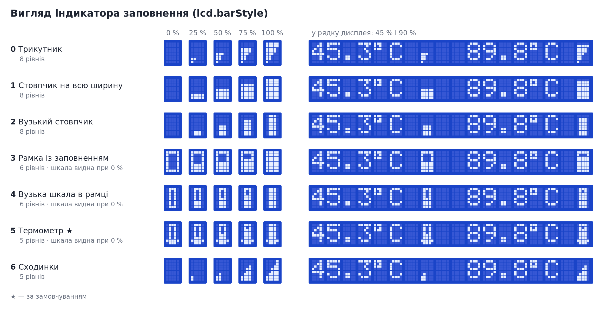

# ThermoHub — довідник HTTP API

Усі приклади нижче — реальні відповіді пристрою. Адреса пристрою в прикладах —
`192.168.1.184` (або `http://thermohub.local`, якщо mDNS працює у вашій мережі).

## Загальні правила

| Що | Як |
|---|---|
| Транспорт | HTTP, порт 80, без TLS |
| Авторизація | немає (пристрій для закритої локальної мережі) |
| Формат | JSON у UTF‑8; виняток — `/metrics` (текст Prometheus) і `/` (HTML) |
| Тіло POST | JSON, **`Content-Type: application/json`** (або `text/plain`). Форми `application/x-www-form-urlencoded` не підтримуються → `Потрібне тіло запиту у форматі JSON`. Максимум 8 КБ |
| Невідомий шлях або метод | `404 {"ok":false,"error":"Не знайдено"}` (наприклад, `GET /api/reboot`) |
| CORS | `Access-Control-Allow-Origin: *` лише в `GET /api/sensors`. Preflight (`OPTIONS`) не підтримується, тож з іншого сайту в браузері доступні лише прості `GET` |
| Кеш | JSON‑відповіді мають `Cache-Control: no-store` |
| Помилки | HTTP 4xx/5xx + `{"ok":false,"error":"<текст>"}`; текст українською, придатний для показу користувачу |

Числа: температури — °C, тиск — гПа і мм рт. ст., час — секунди (`*_s`) або
мілісекунди (`*_ms`, `*Ms`). Значення, яких немає (датчик не відповідає), — `null`.

### Перелік

| Метод | Шлях | Призначення |
|---|---|---|
| GET | [`/api/sensors`](#get-apisensors) | усі показники |
| GET | [`/metrics`](#get-metrics) | показники у форматі Prometheus |
| GET | [`/api/config`](#get-apiconfig) | налаштування + стан пристрою |
| POST | [`/api/config`](#post-apiconfig) | змінити налаштування (частково) |
| POST | [`/api/offset`](#post-apioffset) | поправка одного датчика |
| GET | [`/api/display`](#get-apidisplay) | вміст дисплея + діагностика енкодера |
| POST | [`/api/display/input`](#post-apidisplayinput) | віртуальний енкодер |
| POST | [`/api/display/charset`](#post-apidisplaycharset) | тест знакогенератора LCD |
| GET | [`/api/scan/onewire`](#get-apiscanonewire) | пошук DS18B20 на шині 1‑Wire |
| GET | [`/api/scan/i2c`](#get-apiscani2c) | діагностика і пошук на шині I2C |
| GET | [`/api/scan/wifi`](#get-apiscanwifi) | пошук мереж Wi‑Fi (асинхронний) |
| GET | [`/api/update`](#get-apiupdate) | стан оновлення через інтернет |
| POST | [`/api/update/check`](#post-apiupdatecheck) | перевірити останній реліз (асинхронно) |
| POST | [`/api/update/install`](#post-apiupdateinstall) | встановити знайдене оновлення |
| POST | [`/update`](#post-update) | оновити прошивку з файлу (multipart) |
| POST | [`/api/reboot`](#post-apireboot) | перезавантаження |
| POST | [`/api/factory-reset`](#post-apifactory-reset) | скидання налаштувань |
| GET | [`/`](#get-) | вебадмінка |

---

## Показники

### GET /api/sensors

Знімок усіх датчиків. Читається без побічних ефектів, можна опитувати часто
(дані оновлюються раз на `pollMs`, за замовчуванням 2 с).

```json
{
  "demo": true,
  "ds18b20": [
    {"slot": 1, "demo": true, "name": "H IN", "addr": "", "ok": true,
     "offset": 0, "max": 100, "raw": 22.5, "temp": 22.5, "percent": 22.5},
    {"slot": 3, "demo": true, "name": "B TOP", "addr": "", "ok": true,
     "offset": 0.7, "max": 100, "raw": 62.63, "temp": 63.33, "percent": 63.3}
  ],
  "aht20":  {"ok": true, "temp": 22.48, "humidity": 52.82},
  "bmp280": {"ok": true, "temp": 23.08, "pressure_hpa": 988.74, "pressure_mmhg": 741.61},
  "age_ms": 191,
  "uptime_s": 36,
  "wifi": {"connected": true, "rssi": -55, "ip": "192.168.1.184"}
}
```

| Поле | Тип | Опис |
|---|---|---|
| `demo` | bool | увімкнено демо‑режим (значення DS18B20 емулюються) |
| `ds18b20[]` | масив з 4 елементів | слоти T1…T4, завжди 4 елементи |
| `.slot` | 1…4 | номер слота |
| `.name` | string | назва (UTF‑8, до 63 байт) |
| `.addr` | string | ROM‑адреса датчика, 16 hex‑символів, `""` — слот порожній |
| `.ok` | bool | є свіжі дані (3 невдалі читання поспіль → `false`) |
| `.raw` | number \| null | температура без поправки, °C (крок DS18B20 — 0.0625) |
| `.offset` | number | поправка, °C |
| `.temp` | number \| null | `raw + offset`, °C |
| `.max` | number | максимум для індикатора заповнення, °C |
| `.percent` | number \| null | `temp / max · 100`, обмежено 0…100 |
| `.demo` | bool | значення емульоване |
| `aht20.ok` | bool | датчик відповідає |
| `aht20.temp`, `.humidity` | number \| null | °C, % відносної вологості |
| `bmp280.ok` | bool | датчик відповідає |
| `bmp280.temp` | number \| null | °C |
| `bmp280.pressure_hpa`, `.pressure_mmhg` | number \| null | тиск |
| `age_ms` | number | скільки мс тому оновилися DS18B20 |
| `uptime_s` | number | час роботи пристрою |
| `wifi.connected`, `.rssi`, `.ip` | bool, dBm, string | стан Wi‑Fi (`rssi` = 0 без зв'язку; `ip` — адреса точки доступу, якщо пристрій у режимі налаштування) |

Помилок немає (завжди `200`).

### GET /metrics

Формат Prometheus (`text/plain; version=0.0.4`). Метрики без значення (датчик
не відповідає) не виводяться.

```
# TYPE thermohub_ds18b20_celsius gauge
thermohub_ds18b20_celsius{slot="1",name="H IN"} 22.50
thermohub_ds18b20_demo 1.00
thermohub_aht20_celsius 22.48
thermohub_aht20_humidity_percent 52.82
thermohub_bmp280_celsius 23.08
thermohub_bmp280_pressure_hpa 988.74
thermohub_wifi_rssi_dbm -55.00
thermohub_uptime_seconds 37.00
thermohub_free_heap_bytes 204752.00
```

| Метрика | Мітки | Значення |
|---|---|---|
| `thermohub_ds18b20_celsius` | `slot`, `name` | температура з поправкою |
| `thermohub_ds18b20_demo` | — | 1 — демо‑режим |
| `thermohub_aht20_celsius`, `thermohub_aht20_humidity_percent` | — | AHT20 |
| `thermohub_bmp280_celsius`, `thermohub_bmp280_pressure_hpa` | — | BMP280 |
| `thermohub_wifi_rssi_dbm` | — | сигнал Wi‑Fi |
| `thermohub_uptime_seconds`, `thermohub_free_heap_bytes` | — | службові |

---

## Налаштування

### GET /api/config

Поточні налаштування (`config`) і стан пристрою (`info`). Паролі не віддаються.

```json
{
  "config": {
    "wifi": {"ssid": "OverHill", "hostname": "thermohub", "hasPass": true},
    "pins": {"sda": 21, "scl": 22, "onewire": 4, "encA": 32, "encB": 35, "encBtn": 33},
    "lcd": {"addr": 0, "cols": 20, "rows": 4, "charset": 0, "barStyle": 5,
            "blMode": 1, "blTimeout": 1200},
    "encoder": {"reverse": false, "stepsPerDetent": 4},
    "pollMs": 2000,
    "pressUnit": 1,
    "dsDemo": true,
    "updAuto": false,
    "ds": [{"name": "H IN", "addr": "", "offset": 0, "max": 100}, "…ще 3 слоти…"]
  },
  "info": {
    "version": "1.0.3", "mac": "B0:A7:32:DD:2C:70", "ip": "192.168.1.184",
    "apSsid": "ThermoHub-2C70", "apActive": false,
    "staConnected": true, "staReason": 0, "staProblem": "",
    "lcdAddr": 39, "bmpAddr": 119, "freeHeap": 204616, "uptime_s": 36,
    "update": {"current": "1.0.3", "available": false, "…": "як у GET /api/update, без notes"}
  }
}
```

`info`:

| Поле | Опис |
|---|---|
| `version` | версія прошивки (`1.2.0`; проміжні збірки — `1.2.0-3-gabc1234`) |
| `mac`, `ip` | MAC і поточна IP‑адреса |
| `apSsid`, `apActive` | назва резервної точки доступу і чи вона зараз піднята |
| `staConnected` | підключено до Wi‑Fi‑мережі |
| `staReason`, `staProblem` | код останньої причини відключення ESP‑IDF і її пояснення (`""` якщо проблеми немає) |
| `lcdAddr`, `bmpAddr` | знайдені I2C‑адреси дисплея і BMP280 (0 — не знайдено) |
| `freeHeap`, `uptime_s` | вільна пам'ять, час роботи |
| `update` | стан оновлень, див. [GET /api/update](#get-apiupdate) |

### POST /api/config

Часткове оновлення: передаються лише поля, які треба змінити, у тій самій
структурі, що й у `GET /api/config` → `config`.

```bash
curl -X POST -H 'Content-Type: application/json' \
     -d '{"pollMs":5000,"lcd":{"blMode":1,"blTimeout":600}}' \
     http://192.168.1.184/api/config
```

Відповідь: `{"ok":true,"reboot":false}`. Якщо `reboot: true` — змінено параметр,
що діє лише після перезапуску, і пристрій **сам перезавантажиться** через ~1.5 с.

**Правила:**

- Поле відсутнє або `null` — значення не змінюється. Невідомі ключі ігноруються.
- **Тип має збігатися:** ціле число для цілих полів (`3000`, не `3000.0` і не
  `"3000"`), `true`/`false` для прапорців, рядок для рядків, масив для `ds`.
  Інакше — `400` з поясненням, наприклад `Інтервал опитування: очікується ціле число`.
- **Атомарність:** при першій же помилці не застосовується нічого.
- Відповідь на помилку — лише перша знайдена помилка.

**Усі поля:**

| Поле | Тип | Допустимо | За замовч. | Перезапуск |
|---|---|---|---|---|
| `wifi.ssid` | string | до 32 байт; `""` — не підключатися (лише точка доступу) | `""` | так |
| `wifi.pass` | string | до 64 байт; лише запис (у GET → `hasPass`) | `""` | так |
| `wifi.hostname` | string | до 32 байт; ім'я для mDNS (`<ім'я>.local`) | `thermohub` | так |
| `wifi.apPass` | string | до 64 байт; < 8 символів → точка доступу без пароля; лише запис | `thermohub` | так |
| `pins.sda`, `pins.scl` | int | GPIO з дозволених, здатний на вихід (див. нижче) | 21, 22 | так |
| `pins.onewire` | int | те саме | 4 | так |
| `pins.encA`, `pins.encB`, `pins.encBtn` | int | будь‑який дозволений GPIO (34–39 — лише із зовнішньою підтяжкою) або `-1` — не використовується | 32, 35, 33 | так |
| `lcd.addr` | int | 0…127; `0` — автопошук (0x27, 0x3F, 0x20–0x26, 0x39–0x3E) | 0 | так |
| `lcd.cols` | int | 8…40 | 20 | так |
| `lcd.rows` | int | 1…4 | 4 | так |
| `lcd.charset` | int | `0` — ROM A00, назви транслітом; `1` — ROM із кирилицею | 0 | ні |
| `lcd.barStyle` | int | вигляд індикатора заповнення, див. нижче | 5 | ні |
| `lcd.blMode` | int | підсвітка: `0` завжди, `1` вимикати без дій, `2` вимкнена | 0 | ні |
| `lcd.blTimeout` | int | 10…3600 с — через скільки вимикати в режимі `1` | 300 | ні |
| `encoder.reverse` | bool | інвертувати напрямок | false | ні |
| `encoder.stepsPerDetent` | int | 1…4 (4 — повний цикл на клацання, 2 — половина, 1 — кожен перехід) | 4 | ні |
| `pollMs` | int | 1000…60000 мс — інтервал опитування датчиків | 2000 | ні |
| `pressUnit` | int | тиск на LCD: `0` гПа, `1` мм рт. ст. | 1 | ні |
| `dsDemo` | bool | демо‑режим DS18B20 | false | ні |
| `updAuto` | bool | щоденна автоперевірка оновлень | true | ні |
| `ds` | array | до 4 елементів, по порядку слотів T1…T4; `{}` — пропустити слот | — | ні |
| `ds[].name` | string | до 63 байт UTF‑8 (≈30 кириличних літер) | `T1`…`T4` | ні |
| `ds[].addr` | string | 16 hex‑символів або `""` (звільнити слот); регістр не важливий | `""` | ні |
| `ds[].offset` | number | −20…+20 °C | 0 | ні |
| `ds[].max` | number | 1…999 °C | 100 | ні |

**Пін‑правила** (`400`, якщо порушено): дозволені GPIO `0, 2, 4, 5, 12–19, 21–23,
25–27, 32–39`; GPIO 34–39 лише для входів (енкодер); SDA, SCL і 1‑Wire обов'язкові;
один GPIO не можна призначити двом функціям. GPIO 0, 2, 5, 12, 15 — strapping‑піни,
дозволені, але можуть заважати завантаженню.

**`lcd.barStyle`:**



| Значення | Вигляд | Рівнів | При 0 % |
|---|---|---|---|
| 0 | трикутник від лівого нижнього кута | 8 | порожньо |
| 1 | стовпчик на всю ширину | 8 | порожньо |
| 2 | вузький стовпчик | 8 | порожньо |
| 3 | рамка із заповненням | 6 | порожня рамка |
| 4 | вузька шкала в рамці | 6 | порожня шкала |
| 5 | термометр | 5 | порожній термометр |
| 6 | сходинки | 5 | порожньо |

Приклади:

```bash
# дати назви і максимуми двом першим датчикам, решту не чіпати
-d '{"ds":[{"name":"Подача","max":90},{"name":"Обратка","max":70}]}'
# змінити лише третій слот
-d '{"ds":[{},{},{"offset":-0.3}]}'
# прив'язати датчик до слота 4 / звільнити слот 4
-d '{"ds":[{},{},{},{"addr":"28FF641E8516039C"}]}'
-d '{"ds":[{},{},{},{"addr":""}]}'
# нова мережа (пристрій перезавантажиться)
-d '{"wifi":{"ssid":"MyWiFi","pass":"secret123"}}'
```

Типові помилки (`400`):

```json
{"ok":false,"error":"Інтервал опитування: поза допустимим діапазоном"}
{"ok":false,"error":"Інтервал опитування: очікується ціле число"}
{"ok":false,"error":"dsDemo: очікується true або false"}
{"ok":false,"error":"ds: очікується масив"}
{"ok":false,"error":"I2C SDA: GPIO34 працює лише на вхід"}
{"ok":false,"error":"I2C SCL і I2C SDA на одному GPIO22"}
{"ok":false,"error":"1-Wire: GPIO7 не можна використовувати"}
{"ok":false,"error":"Адреса датчика — 16 шістнадцяткових символів"}
{"ok":false,"error":"Максимальна температура: від 1 до 999 °C"}
{"ok":false,"error":"Ім'я хоста: задовге значення"}
{"ok":false,"error":"Потрібне тіло запиту у форматі JSON"}
{"ok":false,"error":"Некоректний JSON: IncompleteInput"}
```

`500 {"ok":false,"error":"Не вдалося записати у флеш-пам'ять"}` — помилка NVS.

### POST /api/offset

Скорочений спосіб змінити поправку одного датчика.

```bash
curl -X POST -H 'Content-Type: application/json' -d '{"slot":3,"offset":-0.3}' http://192.168.1.184/api/offset
```

| Поле | Тип | Допустимо |
|---|---|---|
| `slot` | int | 1…4, обов'язкове |
| `offset` | number | −20…+20 °C, обов'язкове |

Відповідь `{"ok":true}`. Помилки (`400`): `slot має бути від 1 до 4`, `Не вказано offset`,
`Поправка має бути в межах ±20`; `500` — помилка запису.

---

## Дисплей і енкодер

### GET /api/display

Точна копія того, що зараз на LCD, плюс стан підсвітки і діагностика енкодера.

Параметр запиту `since` (необов'язковий) — номер останньої вже отриманої події
енкодера; повертаються лише новіші (`?since=0` — усі збережені, до 32).

```json
{
  "cols": 20, "rows": 4, "present": true,
  "backlight": true, "blMode": 1, "blOffIn": 1168, "barStyle": 5,
  "lines": [
    "1 H IN     22.5°C ▂D",
    "2 H OUT    45.8°C ▃ ",
    "3 B TOP    63.3°C ▄ ",
    "4 B BOTTOM  5.1°C ▁ "
  ],
  "enc": {
    "pins": {"a": 32, "b": 35, "btn": 33},
    "level": {"a": 1, "b": 1, "btn": 1},
    "pullup": {"a": true, "b": false, "btn": true},
    "raw": 0, "steps": 0, "edgesA": 0, "edgesB": 0, "invalid": 0,
    "stepsPerDetent": 4, "seq": 12,
    "events": [{"seq": 12, "ago": 3110, "type": "C", "src": "hw"}]
  }
}
```

| Поле | Опис |
|---|---|
| `present` | фізичний LCD знайдено (якщо `false`, `lines` — те, що показувалося б) |
| `lines[]` | рядки рівно по `cols` символів. Символи ROM перекладено в UTF‑8: `°` — градус; кирилиця (у режимі `charset: 1`); **`▁`…`▉` (U+2581…U+2589) — індикатор заповнення рівня 0…8** у стилі `barStyle`; `?` — символ, якого немає в таблиці |
| `backlight` | підсвітка зараз увімкнена |
| `blMode` | режим підсвітки (як `lcd.blMode`) |
| `blOffIn` | лише в режимі `1`: через скільки секунд вимкнеться підсвітка |
| `barStyle` | поточний вигляд індикатора |
| `enc.pins` | GPIO енкодера (`-1` — не використовується) |
| `enc.level` | поточні рівні ліній: `1` HIGH, `0` LOW (кнопка натиснута = 0) |
| `enc.pullup` | чи має пін внутрішню підтяжку (GPIO 34–39 — ні) |
| `enc.edgesA`, `edgesB` | кількість перемикань ліній з моменту запуску |
| `enc.invalid` | обидві лінії змінилися одночасно (пропуск/шум) |
| `enc.raw`, `enc.steps` | сирий квадратурний лічильник і зараховані кроки |
| `enc.seq` | номер останньої події |
| `enc.events[]` | `type`: `R` вправо, `L` вліво, `D` кнопку натиснуто, `U` відпущено, `C` клік, `H` довге натискання; `src`: `hw` — енкодер, `web` — віртуальний; `ago` — мс тому; `v` — кількість кроків, якщо > 1 |

### POST /api/display/input

Віртуальний енкодер — те саме, що повернути/натиснути справжній. У відповіді —
оновлений вміст дисплея (як у `GET /api/display`, без `enc`).

| Тіло | Дія |
|---|---|
| `{"turn": 1}` / `{"turn": -1}` | поворот на 1 клацання вправо / вліво; допустимо −10…10 (більші значення обмежуються) |
| `{"press": "click"}` | короткий клік |
| `{"press": "long"}` | довге натискання (вхід/вихід з меню корекції) |
| `{"turn": 1, "press": "click"}` | обидві дії разом |

`400 Потрібно вказати turn або press` — немає ні `turn` ≠ 0, ні `press` зі значенням `click`/`long`.

Якщо підсвітка в режимі `1` вимкнена, перший віртуальний дотик лише вмикає її
(як і зі справжнім енкодером).

### POST /api/display/charset

Тест знакогенератора: на 30–60 с показує на LCD таблицю символів. Корисно, щоб
з'ясувати, чи має дисплей кириличний ROM.

| `page` | Що показує |
|---|---|
| `0` | коди 0xA0–0xDF (тут у кириличних ROM — літери) |
| `1` | коди 0xE0–0xFF і 0x80–0x9F |
| `2` | українська абетка через поточне кодування + два кандидати на `°` |

Інші значення обмежуються до 0…1. Відповідь `{"ok":true}`.

---

## Пошук пристроїв

### GET /api/scan/onewire

```json
{"found": [{"addr": "28FF641E8516039C", "slot": 0}, {"addr": "28AA1B2C3D4E5F60", "slot": 2}]}
```

`slot` — до якого слота прив'язаний датчик (`0` — ні до якого). Прив'язати —
через `POST /api/config` з `ds[].addr`. Нові датчики також самі займають порожні
слоти під час завантаження.

### GET /api/scan/i2c

Діагностика шини I2C: рівні ліній, відновлення «залиплої» шини, пошук на 100 і
10 кГц, повторна ініціалізація AHT20/BMP280.

```json
{"sdaIdle": 1, "sclIdle": 1, "found": [39, 56, 119], "found10k": [39, 56, 119],
 "aht20": true, "bmp280": true}
```

| Поле | Опис |
|---|---|
| `sdaIdle`, `sclIdle` | рівні ліній у спокої, мають бути `1` |
| `recovered`, `sdaAfter`, `sclAfter` | лише якщо лінія була в `0`: виконано 9 тактів SCL + STOP і рівні після цього |
| `found` | адреси, що відповіли на 100 кГц (десяткові: 39 = 0x27 LCD, 56 = 0x38 AHT20, 118/119 = 0x76/0x77 BMP280) |
| `found10k` | те саме на 10 кГц (є лише тут → довгі дроти / слабкі підтяжки) |
| `aht20`, `bmp280` | датчик ініціалізовано після пошуку |

### GET /api/scan/wifi

Пошук займає 2–6 с, тому він асинхронний: перший запит запускає пошук і
відповідає `{"scanning":true}`, наступні — те саме, поки не буде результату.
Опитуйте раз на ~0.7 с.

```json
{"scanning": true}
{"networks": [{"ssid": "OverHill", "rssi": -56, "channel": 9, "open": false}, "…"]}
```

Мережі з однаковою назвою об'єднано (залишено найсильнішу), список відсортовано за
сигналом, приховані мережі пропущено. Результат віддається один раз і живе 15 с.
Під час пошуку зв'язок з пристроєм може на кілька секунд «замерзати» — радіо
перебирає канали. `503` — пошук не вдався, повторіть.

---

## Оновлення прошивки

### GET /api/update

Стан оновлення через інтернет (з GitHub Releases репозиторію `repo`).

```json
{"current": "1.0.3", "repo": "set-st/esp32-thermo", "autoCheck": true,
 "checked": true, "checkedAgo_s": 40, "checking": false,
 "latest": "v1.0.4", "available": true, "notes": "…опис релізу…",
 "url": "https://github.com/set-st/esp32-thermo/releases/tag/v1.0.4", "size": 1151782,
 "error": "", "phase": "idle", "progress": 0, "installError": ""}
```

| Поле | Опис |
|---|---|
| `current`, `latest` | встановлена і остання опублікована версії |
| `available` | є новіша версія з підписаним `firmware.bin` |
| `checking` | перевірка зараз триває |
| `checked`, `checkedAgo_s` | чи була перевірка і як давно |
| `notes`, `url`, `size` | опис релізу (до 2000 символів), сторінка, розмір образу |
| `error` | помилка перевірки (`Релізів ще немає`, `Немає підключення до мережі`, …) |
| `phase` | `idle`, `downloading`, `verifying`, `done` (далі перезапуск), `error` |
| `progress` | 0…100 під час завантаження |
| `installError` | причина збою встановлення (зокрема `Невірний підпис прошивки — оновлення відхилено`) |

### POST /api/update/check

Запускає перевірку у фоні й одразу повертає стан (`"checking": true`). Опитуйте
`GET /api/update`, доки `checking` не стане `false`. Тіло не потрібне.

### POST /api/update/install

Запускає завантаження й встановлення знайденого оновлення у фоні. Перед записом
перевіряється підпис ECDSA; після успіху пристрій перезавантажується. Хід —
у `GET /api/update` (`phase`, `progress`). Тіло не потрібне.

`409` — `Немає доступного оновлення — спершу перевірте` або `Оновлення вже виконується`.

### POST /update

Оновлення з файлу `firmware.bin` (multipart/form-data, будь‑яка назва поля).
Підпис тут **не** перевіряється — це локальне оновлення.

```bash
curl -H 'Expect:' -F 'fw=@firmware.bin' http://192.168.1.184/update
```

`-H 'Expect:'` обов'язковий для curl (інакше він чекає `100-continue`). Відповідь
`{"ok":true}`, потім перезапуск; `500 Помилка оновлення: …` — образ не прийнято.
Якщо з'єднання обірвалося, частковий образ відкидається, і можна одразу повторити.

---

## Система

### POST /api/reboot

Перезавантаження через ~1 с. Тіло не потрібне. Відповідь `{"ok":true}`.

### POST /api/factory-reset

Стирає всі налаштування (включно з Wi‑Fi) і перезавантажує пристрій. Після цього
він піднімає точку доступу `ThermoHub-XXXX` (пароль `thermohub`, адреса
`192.168.4.1`). Тіло не потрібне. Відповідь `{"ok":true}`.

### GET /

Вебадмінка. Віддається стиснутою (`Content-Encoding: gzip`) з `ETag`; запит з
`If-None-Match` поточного тегу отримує `304`.

---

## Приклади

```bash
# поточні температури (лише назва і значення)
curl -s http://192.168.1.184/api/sensors | jq -r '.ds18b20[] | "\(.name): \(.temp)"'

# увімкнути демо-режим
curl -X POST -H 'Content-Type: application/json' -d '{"dsDemo":true}' http://192.168.1.184/api/config

# пошук Wi-Fi з очікуванням результату
while r=$(curl -s http://192.168.1.184/api/scan/wifi); echo "$r" | grep -q scanning; do sleep 0.7; done; echo "$r"

# перевірити і встановити оновлення
curl -X POST http://192.168.1.184/api/update/check
sleep 5; curl -s http://192.168.1.184/api/update | jq '{latest, available, error}'
curl -X POST http://192.168.1.184/api/update/install
```

Prometheus:

```yaml
scrape_configs:
  - job_name: thermohub
    static_configs:
      - targets: ['192.168.1.184:80']
```
